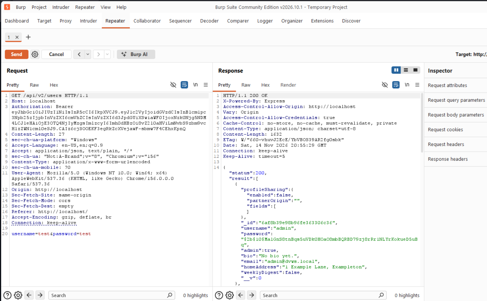
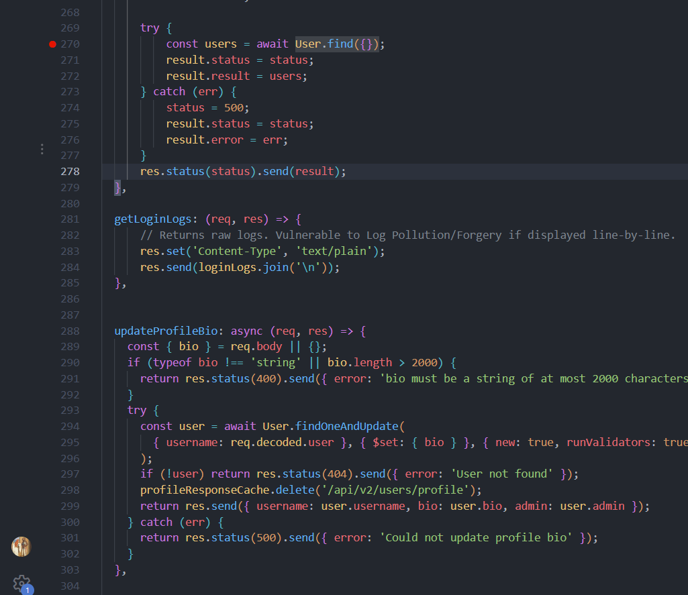
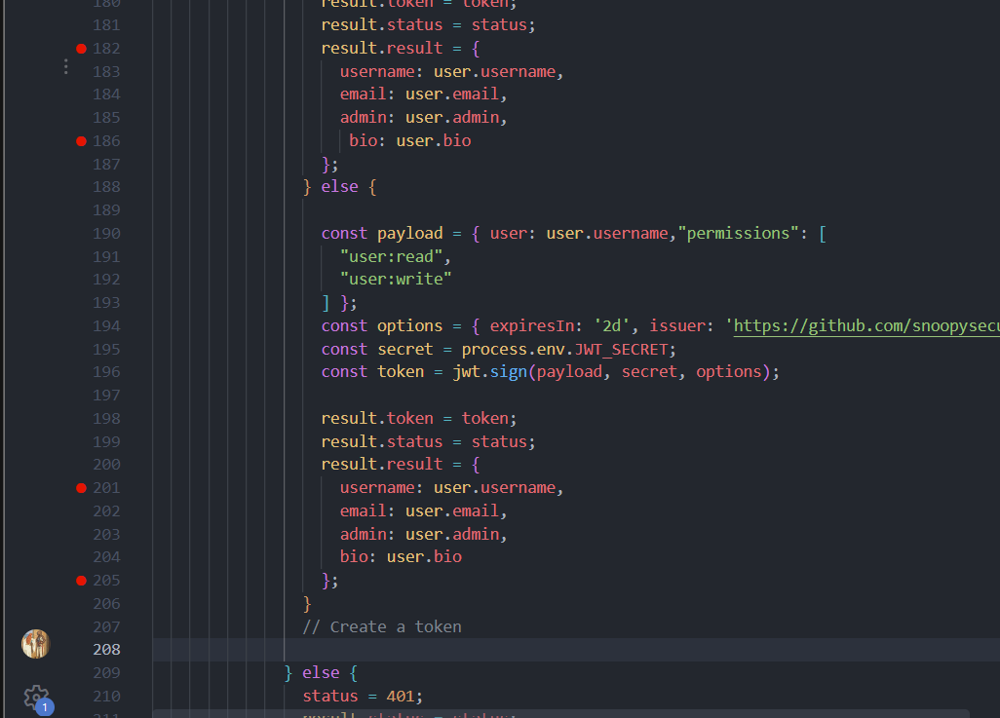
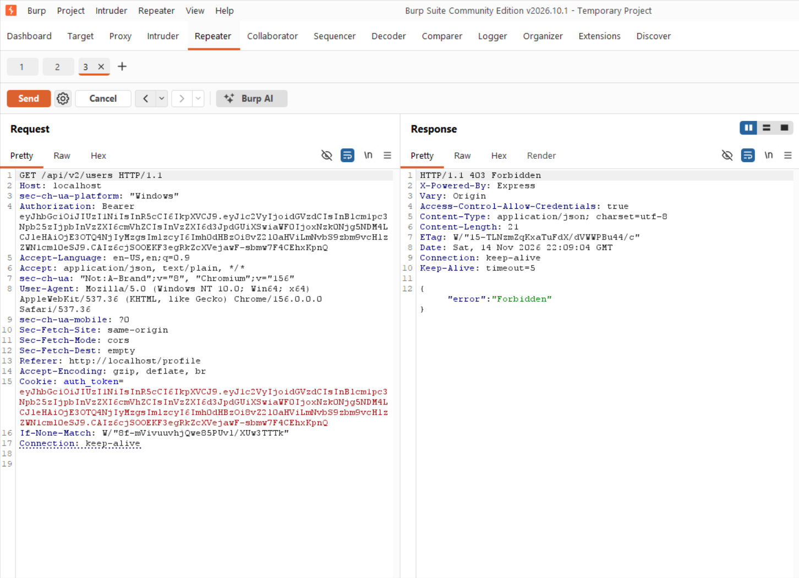

# #27 Sensitive Data Exposure (Password Hashes)

**Owner:** Bashar Zain
**Severity:** High
**Affected endpoints:** `GET /api/v2/users`, `POST /api/v2/users/login`

## Description

The API sends users' bcrypt password hashes back in its responses. We logged in as `test`, a normal user with no admin rights, and sent a request to `GET /api/v2/users` with that user's token in Burp Repeater. The server returned every user in the database with their `password` field, including the admin account.



The login endpoint has the same problem. After a successful login, the response contains the logged-in user's hash:

```json
"result": {
  "username": "test",
  "password": "$2b$10$KF48rmhNFOt1fAZmOMxdj.eLT56KW4ruNRXraPZVgUrVnEsTtqWPS",
  "admin": false,
  "email": "test@dvws.local"
}
```

A hash is not the password itself, but anyone who has it can try to crack it offline, and weak passwords can be recovered this way. Hashes should never leave the server.

## Root cause



In `src/controllers/users.js`, the `getAll` function loads users with `User.find({})`. Mongoose returns every field of the document by default, and nothing excludes `password`, so the hash ends up in the JSON response. The `login` function does the same thing with `result.result = user`, which sends the whole user object back to the client.

There is also a second issue on the same endpoint. In `src/routes/users.js`, the route is protected only by `validateToken`:

```js
router.route('/v2/users')
  .get(validateToken, controller.getAll);
```

`validateToken` checks that the caller is logged in, but it does not check whether the caller is an admin. That is why a normal user can list all accounts. This overlaps with #18 (Vertical Access Control).

## Fix

**1. Exclude the password in `getAll`** (`src/controllers/users.js`):

```js
const users = await User.find({}).select('-password');
```

**2. Don't send the full user object after login** (`src/controllers/users.js`):

```js
result.result = {
  username: user.username,
  email: user.email,
  admin: user.admin,
  bio: user.bio
};
```

We changed this in both places it appears in `login` (the admin branch and the normal user branch).



The login function still reads the hash internally to run `bcrypt.compare`, which is fine. It just no longer sends it back.

**3. Only allow admins to list users** (`src/routes/users.js`):

```js
const requireAdmin = (req, res, next) => {
  const perms = (req.decoded && req.decoded.permissions) || [];
  if (!perms.includes('user:admin')) {
    return res.status(403).send({ error: 'Forbidden' });
  }
  next();
};

router.route('/v2/users')
  .get(validateToken, requireAdmin, controller.getAll);
```

Admin tokens are issued with the `user:admin` permission at login, and normal user tokens are not, so only admins get past this check. We did not use the `guard` from `express-jwt-permissions` that is already imported in this file, because it reads permissions from `req.identity` while `validateToken` stores the token in `req.decoded`, so it would block admins too.

## Verification

After rebuilding with `docker compose up --build`, we will repeat the same Burp request:

- With the `test` user's token, `GET /api/v2/users` should return `403 Forbidden`.
- With an admin token, the user list should come back without any `password` field.
- Logging in should still work, and the login response should not contain `password`.

We tested all three after rebuilding:

With the admin token, `GET /api/v2/users` returns `200 OK` and the full user list, with no `password` field on any user:

```json
{"status":200,"result":[
  {"username":"admin","admin":true,"email":"admin@dvws.local", "...": "no password field"},
  {"username":"test","admin":false,"email":"test@dvws.local", "...": "no password field"}
]}
```



With the `test` user's token, the same request now returns `403 Forbidden`, confirming the admin check works.
